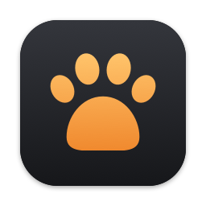
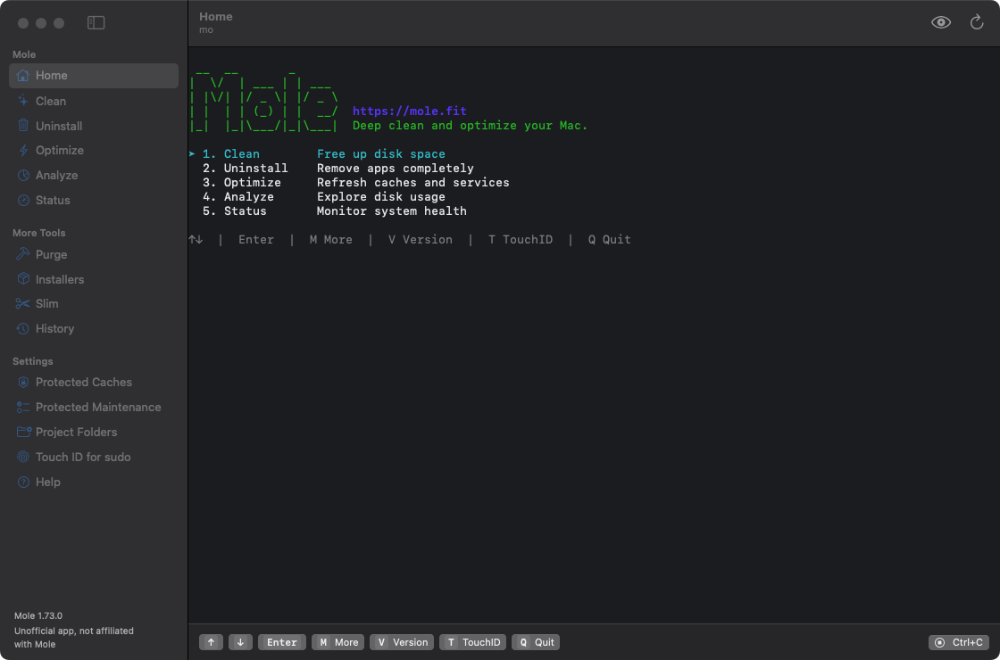

  
  <h1>Pawsweep</h1>
  
<b>A minimal Mac interface for Mole. Click instead of type.</b>

  

    <a href="https://github.com/NezarAli/Pawsweep/releases/latest"><b>Download for Mac</b></a>
    &nbsp;·&nbsp; Free &nbsp;·&nbsp; macOS 13+ &nbsp;·&nbsp; Apple silicon and Intel
  

[Mole](https://github.com/tw93/Mole) is an excellent free Mac cleaner, but it lives in Terminal and
is driven with the keyboard. Pawsweep puts it in a window you can use with the mouse. That's the
whole idea: the same Mole, the same screens, easier to use.

## What it does

- **Every Mole command in a sidebar.** Clean, Uninstall, Optimize, Analyze, Status, Purge,
  Installers, Slim, History and Mole's settings, one click each.
- **Click instead of arrow keys.** Click a row to select it, click a checkbox row to tick it,
  double-click to open. The scroll wheel moves through lists.
- **Keys you can click.** The key hints on screen (`Q Quit`, `Space Select`) are clickable, and the
  bar under the terminal shows the current screen's keys as buttons.
- **Dry Run switch.** One toggle in the toolbar makes Clean, Uninstall, Optimize, Purge, Installers
  and Slim show what they would remove without touching anything.
- **Asks before stopping work.** Switching commands while one is running asks first.
- **Nothing else to install.** Mole comes inside the app.

Pawsweep stays minimal on purpose. It doesn't redesign Mole or add a cleaner of its own: it runs
Mole itself and presses keys for you, so everything Mole does, Pawsweep does exactly the same way.
The keyboard keeps working as in Terminal.

## Install

1. Download `Pawsweep-<version>.zip` from the [latest release](https://github.com/NezarAli/Pawsweep/releases/latest).
2. Unzip it and move **Pawsweep** to your Applications folder.
3. Open it. The first time, macOS blocks it, because Pawsweep isn't signed with a paid Apple
   Developer ID: open **System Settings → Privacy & Security**, scroll to the message about
   Pawsweep, and click **Open Anyway**.
4. Optional: give Pawsweep **Full Disk Access** (System Settings → Privacy & Security → Full Disk
   Access), so Mole can clean everything it can from a Terminal that has it.

## Staying up to date

When Mole publishes a release, a new Pawsweep with that Mole inside follows within a day,
automatically. Download it from [Releases](https://github.com/NezarAli/Pawsweep/releases) and replace
the old app. Each release links to what's new in Mole.

## Safety

Pawsweep only presses keys; Mole's own rules apply. Clean, Purge and Installers delete permanently,
while Uninstall, Analyze and Slim move files to the Trash after you confirm. Try Dry Run first.
Mole records what it removed in `~/Library/Logs/mole/operations.log` (see History).

## Credits

Pawsweep is built on [Mole](https://github.com/tw93/Mole) by tw93 and its contributors, and on the
[SwiftTerm](https://github.com/migueldeicaza/SwiftTerm) terminal. It is a community project, not
affiliated with or endorsed by Mole, and not the paid [Mole for Mac](https://mole.fit) app. "Mole"
is the Mole project's trademark.

This repository is a fork of Mole: Pawsweep's code is in [`mac/`](../mac) (how it works, building
and releasing are in [mac/README.md](../mac/README.md)), and the rest is Mole, kept in step with
its releases. GPL-3.0, like Mole.
